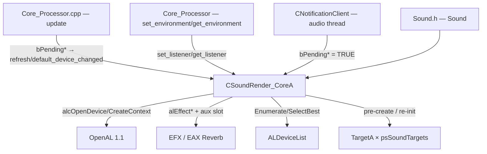

# xrSound — Устройства и прочее

**Файлы**: `SoundRender_CoreA.h` (109 стр.), `SoundRender_CoreA.cpp` (568),
`OpenALDeviceList.h` (63), `OpenALDeviceList.cpp` (239),
`NotificationClient.h` (59), `NotificationClient.cpp` (95), `guids.cpp` (10),
`cl_intersect.h` (870, дубль `xrEngine`).

Закрытый слой `CSoundRender_CoreA : CSoundRender_Core` — **устройство
OpenAL/EFX**: перечисление и выбор устройств, создание/смена device/context,
EFX-эффект реверберации с aux-слотом, listener (позиция/скорость/ориентация),
hot-swap устройства и реакции на изменение устройств ОС
(`CNotificationClient`). Плюс «прочее»: дубль `cl_intersect.h`,
`guids.cpp`, статистика (см. [core](core.md) §8).

См. [Интерфейс и точка входа](interface.md) (порц. 5), [Core — ядро](core.md)
(порц. 6), [Core — процессор и окружение](core-processor-env.md) (порц. 7),
[Обзор](index.md).

## Ответственность

- **Перечисление устройств**: `ALDeviceList::Enumerate` (OpenAL 1.1
  `ALC_ENUMERATE_ALL_EXT`) → `m_devices` + `m_defaultDeviceName` + глобальный
  `snd_devices_token` (token-комплектация консоли, ит.2 порц.12);
- **Выбор устройства**: `SelectBestDevice` — «лучшее» = максимальная AL-версия
  среди устройств с именем системного дефолта, иначе первый;
- **Создание/смена устройства**: `_initialize(stage 0/1)` (device → context →
  listener → 31 EFX-процедур → `LoadEffect` → pre-создание `psSoundTargets`
  targets), `switch_device` (hard-swap), `_clear`, `_restart`;
- **EFX-реверберация**: `LoadEffect`/`load_reverb`/`commit`/`DestroyEffect`,
  `set_listener`/`get_listener` (EAX-поля ↔ `CSoundRender_Environment`);
- **Listener**: `update_listener` (EMA-скорость, flip `-z`,
  `bListenerMoved`);
- **Реакция на ОС**: `CNotificationClient` (Windows Core Audio
  `IMMNotificationClient`) → volatile-флаги → `refresh_devices`/
  `default_device_changed`.

## Место в архитектуре

`CSoundRender_CoreA` создаётся фабрикой `_create(stage)` в `sound.cpp`
([interface](interface.md) §«Точка входа»), глобал `CSoundRender_CoreA*
SoundRenderA` (def здесь, `extern`-объявление в `Sound.h`) — единственная
точка, куда пишут `CNotificationClient` (`friend`).

## Публичный API

- `virtual void _initialize(int stage)` / `_clear()` / `_restart()` — override
  [core](core.md) §4;
- `virtual void refresh_devices()` / `default_device_changed()` /
  `switch_device(LPCSTR)` — override (базовые в Core — no-op);
- `virtual void set_master_volume(float)` — `alListenerf(AL_GAIN)`;
- `virtual const Fvector& listener_position()` — `Listener.position`;
- `virtual void update_listener(P, D, N, dt)` — override (база в Core —
  пустая);
- EFX: `LoadEffect()`, `DestroyEffect()`, `load_reverb(effect, reverb)`
  (1/0), `set_listener(env)`, `get_listener(env)`, `commit()`;
- публичные поля `ALuint effect` / `effectfv` / `slot` (`effectfv` —
  не используется нигде).

## Внутреннее устройство

### 1. `ALDeviceDesc` и `ALDeviceList` (`OpenALDeviceList.h/.cpp`)

Файл — **Creative Labs, 2005 (BSD-лицензия)**, портирован в форк (адаптация
под OpenAL Soft).

- `ALDeviceDesc` — `name` (дисплейное, string256), `name_al` (OAL-спецификатор
  для `alcOpenDevice`), AL/EFX major/minor, `union ESndProps` (биты
  `selected/efx/xra` — **нигде не пишутся**, ctor ставит `storage=0`;
  закомм. `eax_unwanted`).
- `ALDeviceList` — `xr_vector<ALDeviceDesc> m_devices` +
  `string256 m_defaultDeviceName`; ctor → `Enumerate()`; dtor →
  `free_devices_token()`.
- `Enumerate()` —
  - `Msg("... enumerate devices...")`, `free_devices_token()`,
    `m_devices.clear()`;
  - лямбда `list_audio_devices` парсит double-null-список OAL:
    `UTF8_to_CP1251`, **срез префикса " on "** («OpenAL Soft on X» → «X»),
    `DeviceNameList`/`DeviceOALNameList`;
  - в начало — `"Default Device"` +
    `alcGetString(nullptr, ALC_DEFAULT_DEVICE_SPECIFIER)`;
  - при `ALC_ENUMERATE_ALL_EXT` — `ALC_ALL_DEVICES_SPECIFIER`,
    `m_defaultDeviceName = DeviceNameList[0]` (это «Default Device»),
    далее по каждому: `alcOpenDevice` → 4× `alcGetIntegerv` (версии) →
    `push_back(ALDeviceDesc)` → `alcCloseDevice`. Иначе Msg
    «EnumerationExtension NOT Present» (список = только Default Device);
  - сборка **`snd_devices_token`** (`xr_alloc<xr_token>`, имена `xr_strdup`,
    терминатор `id=-1`) — для token-комплектации консоли (def — в `sound.cpp`,
    ит.2 порц.12);
  - лог всех устройств со spec/EFX-версиями.
- `GetDeviceName(i)` — `snd_devices_token[i].name`; `GetDeviceDescByName` —
  линейный `_stricmp`; `GetDeviceVersion(i, ...)` — из desc.
- `SelectBestDevice()` — **только при `snd_device_name.empty()`**: среди
  устройств с именем `m_defaultDeviceName` — максимальная AL-версия;
  fallback — `GetDeviceName(0)`; результат → `snd_device_name`.
- `#ifdef _EDITOR`: глобал `pLog` + callback `al_log` (для редактора).

### 2. `CSoundRender_CoreA` — поля

- `ALCdevice* pDevice` / `ALCcontext* pContext` / `ALDeviceList* pDeviceList`;
- `SListener Listener` — `position`, `prevVelocity`, `curVelocity`,
  `accVelocity`, `orientation[2]`;
- **31 EFX-указатель** (Filter ×11, Effect ×10, AuxSlot ×10 — см. .h) +
  публичные `effect`/`effectfv`/`slot`;
- `friend CNotificationClient`; глобал `CSoundRender_CoreA* SoundRenderA`
  (def в .cpp, объявление в .h + `Sound.h`).

### 3. Макросы и глобалы

- `A_CHK(expr)` / `AC_CHK(expr)` — в **DEBUG**: `alGetError()`/
  `alcGetError(pDevice)` до, `VERIFY2(error == AL_*_NO_ERROR, ...)` после;
  в release — просто `expr` (проверка ошибок OpenAL — только отладочная).
- `FUNCTION_CAST(T, ptr)` — `reinterpret_cast<T>(ptr)`.
- `BOOL reverb_overwrite = FALSE` + **21 `psReverb*`** (float/bool) —
  дефолты из `AL_EAXREVERB_DEFAULT_*` (объявления extern — в `Sound.h`,
  ит.2 порц.12);
- `namespace soundSmoothingParams` — **определения** (объявления — в
  `Sound.h`): `distanceBasedDelayPower=1`, `distanceBasedDelayMinDistance=50`,
  `pitchVariationPower=0`, `power=1.8`, `steps=15`, `alpha = getAlpha()`
  (`2/(steps+1) = 0.125`), `getTimeDeltaSmoothing()` → `alpha` (dt-вариант
  закомм.), `getSmoothedValue(target, cur, sm)` → `cur + sm*(target−cur)`.

### 4. `LoadEffect` / `load_reverb` / `commit` / `DestroyEffect`

- `LoadEffect()` — `alGenEffects(1, &effect)` + `load_reverb(effect,
  &reverbs[0])` (Generic-пресет из `SoundEnvironment_LIB`,
  [core-processor-env](core-processor-env.md) §3); `alGetError()`:
  при `psSoundFlags.test(ss_EFX)` и отсутствии ошибки —
  `Msg("... EFX supported")`, **`m_is_supported = true`** (поле **Core**,
  ставится из CoreA — ит.2 порц.6), `alGenAuxiliaryEffectSlots(1, &slot)`;
  при ошибке — Msg + `alDeleteEffects` (если валиден). Без флага `ss_EFX` —
  «EFX disabled», `m_is_supported = false` (звук работает без EFX).
- `load_reverb(effect, reverb)` — `alEffecti(AL_EFFECT_TYPE,
  AL_EFFECT_EAXREVERB)` (ошибка → Msg + 0); 22 `alEffectf/iv/i`
  (20 float + 2 vec `REFLECTIONS_PAN`/`LATE_REVERB_PAN` + int
  `DECAY_HFLIMIT`); `alGetError()` → 1/0.
- `commit()` — слоту: `AL_EFFECTSLOT_GAIN=1`, `AUXILIARY_SEND_AUTO=false`,
  `EFFECTSLOT_EFFECT=effect` (слот **копирует** свойства effect — effect
  потом можно менять/удалять).
- `DestroyEffect()` — при `m_is_supported`: `alDeleteEffects(1, &effect)` +
  `alDeleteAuxiliaryEffectSlots` (если `alIsAuxiliaryEffectSlot(slot)`).

### 5. `set_listener` / `get_listener` (EAX ↔ Environment)

- `set_listener(env)` — при `reverb_overwrite`: 21 `psReverb*` →
  `alEffectf/i`; иначе 10 базовых полей env (`Diffusion`, `Room`, `RoomHF`,
  `DecayTime`, `DecayHFRatio`, `Reflections`, `ReflectionsDelay`, `Reverb`,
  `AirAbsorptionHF`, `RoomRolloffFactor`); при
  `env.version == sndenv_ver_extended` (5) — ещё 10 (LF, HFLimit, Echo,
  Modulation, refs, Density); **строки `REFLECTIONS_PAN`/`LATE_REVERB_PAN`
  закомментированы** (pan не применяется к железу).
- `get_listener(env)` — 22 `alGetEffectf` + 1 `alEffecti` (`DECAY_HFLIMIT`
  читается через **`alEffecti` с записью** в `(ALint)env.DecayHFLimit`, а не
  `alGetEffecti` — см. «Обнаружено»).

### 6. `refresh_devices` / `default_device_changed` / `switch_device`

- `refresh_devices()` — `pDeviceList->Enumerate()` + Msg; 0 устройств →
  return; текущего `snd_device_name` нет в списке → Msg «! ... switching to
  default» + `switch_device(GetDefaultDeviceName())`.
- `default_device_changed()` — при `_stricmp(snd_device_name,
  GetDefaultDeviceName()) == 0` → `switch_device(GetDefaultDeviceName())`
  (переключается только когда текущее имя **совпадает** с новым дефолтом —
  «Обнаружено»).
- `switch_device(name)` — early-return: `!pDevice || !pContext || !pDeviceList`
  или устройство не найдено (Msg «!»); `alcOpenDevice(name_al)` →
  `alcCreateContext` (сбой → close + return); затем **hard-swap**:
  `bReady = false`, `pause_emitters(true)`, **уничтожение всех targets**
  (`_destroy()`), `DestroyEffect()`, swap `pDevice/pContext` +
  `snd_device_name = deviceDesc.name`, `alcMakeContextCurrent(new)`,
  `alcDestroyContext(old)`, `alcCloseDevice(old)`, re-`_initialize()` всех
  targets, `LoadEffect()`, `restart_emitters()`, `pause_emitters(false)`,
  `bReady = true`, Msg.

### 7. `_initialize(stage)`

- **stage 0**: `pDeviceList = xr_new<ALDeviceList>()` (ctor → `Enumerate`);
  0 устройств → `CHECK_OR_EXIT(0, "OpenAL: Can't create sound device.")` +
  delete; return;
- **stage 1**: `SelectBestDevice()`; сохранённый `snd_device_name` не найден
  → Msg «! Falling back to default» + `snd_device_name = ""` + повторный
  `SelectBestDevice()`; `R_ASSERT2`; `alcOpenDevice` (сбой →
  `CHECK_OR_EXIT` + `bPresent = FALSE` + return);
  `alcGetString(DEVICE_SPECIFIER)`; `alcCreateContext` (сбой → `CHECK_OR_EXIT`
  + close + return); очистка ошибок; `AC_CHK(alcMakeContextCurrent)`;
  listener-инициализация (POSITION/VELOCITY 0, ORIENTATION
  `(0,0,1),(0,1,0)`, GAIN 1); `#define LOAD_PROC(T,x)` — загрузка всех 31
  EFX-процедур через `alGetProcAddress`; `LoadEffect()`; обнуление `Listener`;
  `inherited::_initialize(stage)`; затем **pre-создание targets**:
  цикл `xr_new<CSoundRender_TargetA>()` × `psSoundTargets`; сбой
  `_initialize()` → `Log("! Max targets - ", tit)` +
  `Console->Execute("snd_targets <tit>")` (самоснижение cvar'а) +
  `_destroy()` + delete + break.

### 8. `_clear` / `_restart` / `set_master_volume` / `update_listener`

- `_clear()` — `inherited::_clear()`, destroy+delete всех targets,
  `alcMakeContextCurrent(NULL)`, `alcDestroyContext`, `alcCloseDevice`,
  `xr_delete(pDeviceList)`;
- `_restart()` — только `inherited::_restart()`;
- `set_master_volume(f)` — `alListenerf(AL_GAIN, f)` при `bPresent`;
- `update_listener(P, D, N, dt)` — `PROF_EVENT("Sound: update_listener")` +
  `inherited::update_listener` (пустая в Core); `curVelocity = P −
  Listener.position`; по осям: `accVelocity = getSmoothedValue(curVelocity *
  power / dt, accVelocity, alpha)` (EMA, power=1.8, alpha=0.125);
  `prevVelocity = accVelocity`; Msg закомм.; `!Listener.position.similar(P)`
  → set + **`bListenerMoved = TRUE`** (потребитель —
  [core-processor-env](core-processor-env.md) §2);
  `orientation[0] = (D.x, D.y, −D.z)`, `orientation[1] = (N.x, N.y, −N.z)`
  (**flip −z**, Y-up→Z-up — как в TargetA); `alListener3f(AL_POSITION, x, y,
  −z)`, `AL_VELOCITY` из `prevVelocity`, `AL_ORIENTATION` из
  `orientation[0]`.

### 9. `CNotificationClient` (`NotificationClient.h/.cpp`)

Windows Core Audio, COM. Класс `CNotificationClient : IMMNotificationClient`
(форк-добавление, не в оригинале Monolith):

- IUnknown вручную: `AddRef`/`Release` (`InterlockedIncrement/Decrement`,
  `delete this` при 0), `QueryInterface` (IUnknown +
  IMMNotificationClient);
- ctor → `Start()`: `CoInitialize(NULL)` (терпит `RPC_E_CHANGED_MODE`),
  `CoCreateInstance(MMDeviceEnumerator)`,
  `RegisterEndpointNotificationCallback(this)`; `m_bComInitialized` — только
  если инициализировал сам (иначе не `CoUninitialize`);
- dtor → `Close()`: unregister + release enumerator + `CoUninitialize` при
  своём init;
- **колбэки вызываются на аудио-потоке ОС** и **только ставят volatile-флаги**
  (без OpenAL-вызовов — thread-safety):
  - `OnDefaultDeviceChanged(flow, role, id)` — только
    `eRender + eConsole` → `SoundRenderA->bPendingDefaultDeviceSwitch = TRUE`;
  - `OnDeviceRemoved` / `OnDeviceStateChanged` / `OnPropertyValueChanged` →
    `SoundRenderA->bPendingDeviceListRefresh = TRUE`;
  - `OnDeviceAdded` — no-op.
- Флаги `volatile BOOL bPendingDefaultDeviceSwitch` /
  `bPendingDeviceListRefresh` — поля **`CSoundRender_Core`**
  (`SoundRender_Core.h`), читаются в шаге 1 `Core::update`
  ([core-processor-env](core-processor-env.md) §2.1): `bPendingDeviceListRefresh`
  → `refresh_devices()`, `bPendingDefaultDeviceSwitch` →
  `default_device_changed()` (обе сбрасывают флаг).

### 10. `cl_intersect.h` и `guids.cpp`

- `cl_intersect.h` (870 стр.) — **почти дубль `xrEngine/cl_intersect.h`**
  (870 стр., diff — только whitespace в комментариях/макро-деф'ах). Функции
  (`CDB::IntersectRaySphere`/`TestRayTri`/`TestRayTri2`/`TestBBoxTri`/
  `MgcSqrDistance`/`TestSphereTri`/`TestSphereOBB`/`TestRayOBB`) полностью
  описаны в [xr-engine/misc](../xr-engine/misc.md) (ит.2 порц.12). Дублирование
  — «Обнаружено».
- `guids.cpp` (10 стр.) — `#define INITGUID` + `#include <dsound.h>`:
  статические определения GUID'ов вместо линковки `dxguid.lib`
  (комментарий «replaces `#pragma comment(lib, "dxguid")`»).

### 11. Статистика

`CSoundRender_Core::statistic(dest, ext)` (кросс-обязательство ит.2 порц.12,
`CSound_stats_ext`) — полностью описана в [core](core.md) §8 (сбор
статистик) и [core-processor-env](core-processor-env.md) §2.4; здесь — только
указание: `CSoundRender_CoreA` в статистику не вмешивается (поля
`m_stat_*` — в Core).

## Взаимодействие

- **`CNotificationClient`** (аудио-поток) → volatile-флаги → `Core::update`
  (шаг 1) → `refresh_devices`/`default_device_changed` (§6);
- **`Core_Processor`** → `set_environment`/`get_environment` →
  `set_listener`/`get_listener` (§5); `update` → `update_listener` (§8);
- **`Core`** → `_create_data`/`destroy` → pre-созданные targets
  (`s_targets`, §7); `switch_device` → destroy/re-init targets +
  `LoadEffect` (§6);
- **`TargetA`** — `s_targets[i]` (§6–§7; детали —
  [source-target](source-target.md));
- **`SoundEnvironment_LIB`** — `reverbs[0]` (Generic) в `LoadEffect`
  ([core-processor-env](core-processor-env.md) §3);
- **xrEngine** — `CConsole* Console` (самоснижение `snd_targets`),
  `xr_token`/`xr_strdup`, `UTF8_to_CP1251`, `CHECK_OR_EXIT`, `PROF_EVENT`.

## Потоки

- Основной: `_initialize`, `switch_device`, `_clear`, `LoadEffect`,
  `set/get_listener`, `update_listener`, `refresh_devices`,
  `default_device_changed` — в `Core::update`/`_create`/`_destroy`
  (game-поток);
- **Аудио-поток ОС**: колбэки `CNotificationClient` — только volatile-флаги,
  чтение — в game-потоке (`volatile`);
- OpenAL-вызовы — только в game-потоке (аудио-поток не трогает `SoundRenderA`
  напрямую).

## Конфигурация

- `snd_targets` (cvar, `psSoundTargets` в .cpp) — число pre-созданных
  targets; при нехватке OpenAL-ресурсов **самоснижается** через
  `Console->Execute("snd_targets N")` (§7);
- `snd_device_name` (глобал, def — `sound.cpp`) — имя активного устройства
  (сохраняется/читается; `SelectBestDevice` пишет, `switch_device` обновляет);
- `snd_devices_token` (глобал, def — `sound.cpp`) — token-список устройств
  для консоли, собирается `Enumerate`;
- `reverb_overwrite` + 21 `psReverb*` — ручной override EAX-параметров
  (вместо env-значений), дефолты `AL_EAXREVERB_DEFAULT_*`;
- `soundSmoothingParams::power/steps/alpha` — сглаживание скорости listener
  (§3); `distanceBasedDelayPower`/`distanceBasedDelayMinDistance` — preplay
  delay (потребитель — [emitter](emitter.md) §3);
- `psSoundFlags.test(ss_EFX)` — включение EFX (flag'и — в
  [interface](interface.md));
- консоль: `sounddevice <имя>` → `switch_device` (ит.2 порц.12),
  `snd_restart` → `_restart`.

## Известные ограничения

- **`A_CHK`/`AC_CHK`** — проверка ошибок OpenAL только в DEBUG (в release —
  no-op);
- `m_is_supported` — поле **Core**, ставится из CoreA (`LoadEffect`);
  без EFX звук работает, но aux-слот не создаётся;
- `switch_device` — hard-swap: все targets уничтожаются/пересоздаются,
  эмиттеры паузятся/рестартятся; прерывание в полпути невозможно;
- `default_device_changed` — срабатывает только при совпадении текущего имени
  с новым дефолтом (§6, «Обнаружено»);
- `get_listener` — `GAINHF`→`RoomLF` (copy-paste, §5, «Обнаружено»).

## Обнаружено

1. `get_listener` L238 — `AL_EAXREVERB_GAINHF` читается в **`env.RoomLF`**
   (copy-paste; должно быть `GAINLF`) — подтверждено (уже в логе порц. 5);
2. `set_listener` — строки `REFLECTIONS_PAN`/`LATE_REVERB_PAN`
   **закомментированы** (pan из env не доходит до железа);
3. `default_device_changed()` — переключается только когда
   `_stricmp(snd_device_name, GetDefaultDeviceName()) == 0` (текущее имя уже
   совпадает с новым дефолтом) — задокументировано как есть;
4. `switch_device` — hard-swap (destroy всех targets + effect → reopen →
   re-init targets → `LoadEffect` → restart emitters), `bReady`-latch,
   `pause_emitters(true/false)`-скобка;
5. `_initialize` stage 1 — pre-создание targets: при сбое
   **самоснижение `snd_targets`** через `Console->Execute` (self-healing
   конфигурация);
6. `ALDeviceDesc::ESndProps`-биты (`selected`/`efx`/`xra`) — **нигде не
   пишутся** (мёртвые поля, ctor `storage=0`);
7. `SelectBestDevice` — работает только при пустом `snd_device_name`;
   «лучшее» = макс. AL-версия среди устройств с именем `m_defaultDeviceName`,
   иначе первый;
8. `Enumerate` — `UTF8_to_CP1251` + срез « on »-префикса (адаптация под
   OpenAL Soft); сборка `snd_devices_token` (глобал, освобождение только в
   dtor);
9. `update_listener` — скорость = `(P − prevP) * power / dt`, EMA
   (power=1.8, alpha=2/16=0.125); flip `-z` позиции/скорости/ориентации
   (Y-up→Z-up, как в TargetA);
10. `A_CHK`/`AC_CHK` — проверка ошибок OpenAL **только в DEBUG**;
11. `LOAD_PROC` — 31 EFX-указатель через `alGetProcAddress` при инициализации
    контекста; без EFX — `m_is_supported=false`, но модуль продолжает;
12. `CNotificationClient`-колбэки — на **аудио-потоке**, только
    volatile-флаги (без OpenAL-вызовов — thread-safety паттерн);
13. `effectfv` — публичное поле, **не используется** нигде (объявлено,
    записей нет);
14. `guids.cpp` — `INITGUID` + `<dsound.h>` вместо `dxguid.lib`;
15. `cl_intersect.h` — **дубль** `xrEngine/cl_intersect.h` (870 стр. × 2, diff
    — только whitespace).

Кросс-обязательства: ит.2 порц.12 (`CSound_stats_ext`/`statistic()` — §11,
закрыто порц. 5/6/7); ит.2 порц.4 (`CSound_manager_interface`/
`CSound_emitter` — закрыто порц. 5/9); ит.2 порц.6 (`Sound->set_geometry_occ`
— закрыто порц. 6); ит.3 порц.4 (`get_occlusion_to` — закрыто порц. 8);
ит.2 порц.8 (`CSound_environment`/`SoundEnvironment_LIB` — закрыто порц. 7);
ит.3 порц.16 (`ParticleManager`/`PAPI` internals — закрыто порц. 1–3).

Не покрыто: — (итерация 4 завершена).

См. [Интерфейс и точка входа](interface.md) (порц. 5), [Core — ядро](core.md)
(порц. 6), [Core — процессор и окружение](core-processor-env.md) (порц. 7),
[Source + Target](source-target.md) (порц. 8), [Emitter](emitter.md) (порц. 9),
[Обзор](index.md).
