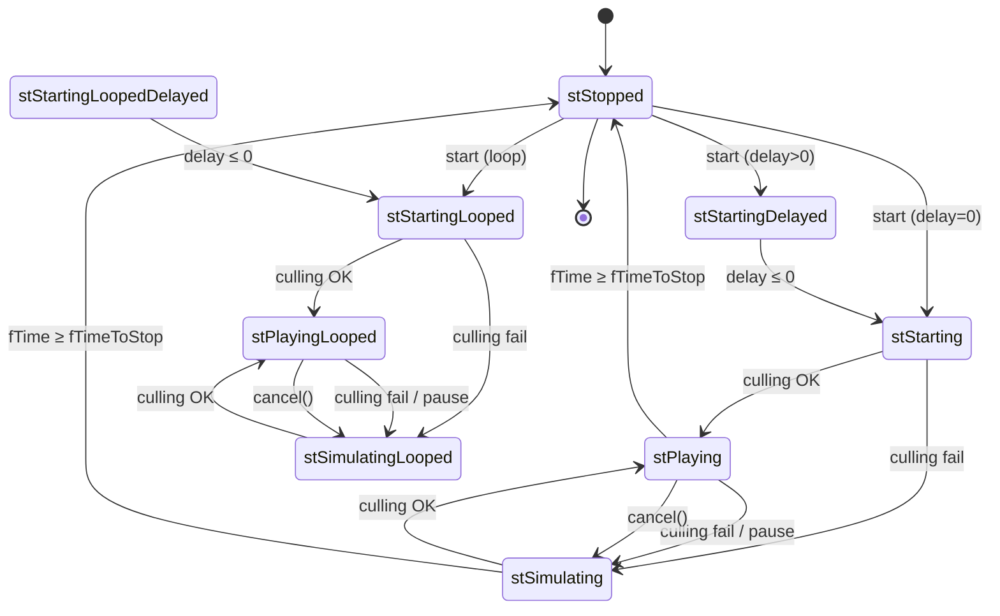

# Emitter — state-машина звукового потока

**Файлы**: `SoundRender_Emitter.h` (133 стр.), `SoundRender_Emitter.cpp` (158),
`SoundRender_Emitter_FSM.cpp` (424), `SoundRender_Emitter_StartStop.cpp` (102),
`SoundRender_Emitter_streamer.cpp` (167).

`CSoundRender_Emitter : CSound_emitter` — **активный экземпляр играющего звука**.
Один `ref_sound_data` может иметь максимум один эмиттер одновременно
(`owner_data->feedback` — указатель на него). Создаётся `CSoundRender_Core`
(`i_play`, [core](core.md) §6), тикается в `Core::update` (r-emitters через
targets — marker-схема, остальные — по `s_emitters`), удаляется `Core`'ом,
когда `!isPlaying()`. Реализует 12 чистых виртуальных
[interface](interface.md) §`CSound_emitter`.

## 1. Поля (`SoundRender_Emitter.h`)

- `State` — 10 состояний: `stStopped=0`, `stStartingDelayed`,
  `stStartingLoopedDelayed`, `stStarting`, `stStartingLooped`, `stPlaying`,
  `stPlayingLooped`, `stSimulating`, `stSimulatingLooped`,
  `stFORCEDWORD=u32(-1)` (используется только как sentinel, в FSM не
  встречается);
- `target` — `CSoundRender_Target*` (OpenAL-ресурс, [source-target](source-target.md));
  `source()` — down-cast `owner_data->handle` → `CSoundRender_Source*`;
  `owner_data` — `ref_sound_data_ptr` (владелец, см. §5 владение);
- громкости: `priority_scale=1`, `smooth_volume=1` (итоговая, уходит в
  `TargetA::fill_parameters` gain), `occluder_volume=1` (комментарий `USER`),
  `fade_volume=1` (fade-in/out), `occluder[3]` — кэш трёх вершин
  окклюдирующего треугольника (вход в `get_occlusion`, [core](core.md) §7);
- FSM: `m_current_state=stStopped`, `m_stream_cursor` (абсолютный байтовый
  курсор по всей «ленте»), `m_cur_handle_cursor` (начало текущего source-
  сегмента, для attached-перехода), `p_source` (`CSound_params`:
  position/min/max/base_volume/volume/freq/`pitch_variation`/
  max_ai_distance/velocity-скользящее-среднее);
- флаги: `iPaused=0` (id паузы), `bMoved=TRUE`, `b2D=FALSE`, `bIntro=false`,
  `bStopping`, `bRewind`; времена `fTimeStarted`/`fTimeToStop`/
  `fTimeToPropagade` (все в сек, база — `SoundRender->fTimer_Value`);
  `marker=0xabababab` (marker-схема `Core::update`, [core](core.md) §5);
  `starting_delay=0`, `need_preplay_update=true`, DEBUG `dbg_ID`
  (инкрементальный static).

## 2. Конструктор/деструктор, события, курсор (`SoundRender_Emitter.cpp`)

Ctor — все дефолты из §1, `set_cursor(0)`. Dtor — только
`Event_ReleaseOwner()`: линейный обход `SoundRender->s_events`, удаление всех
`pair.first == owner_data` (`it--` после `erase`).

`Event_Propagade()` — «звук дошёл до слушателя»:
`fTimeToPropagade += randF(0.47, 0.53)` (`s_f_def_event_pulse=0.5` —
[interface](interface.md) §SoundRender.h); дальше требует
`owner_data->g_type != 0`, `g_object`, `Handler`;
`range = min(max_ai_distance, max_ai_distance*volume)`; `< 0.1` → skip;
push `mk_pair(owner_data, range)` в `s_events` (потребитель —
`update_events`, [core-processor-env](core-processor-env.md) §2.3).

`set_position` — mono source → `p_source.update_position(pos)` (скользящее
среднее velocity, [interface](interface.md) §`CSound_params`),
**стерео → `(0,0,0)`**; всегда `bMoved=TRUE`.

`switch_to_2D` — `b2D` + `set_priority(100)`; `switch_to_Intro` —
`bIntro`+`b2D`+priority 100 (`bIntro` — только для выбора EFX-слота в
TargetA, [source-target](source-target.md)); `switch_to_3D` — **только
`b2D=FALSE`** (`bIntro` не сбрасывается — quirk).

`play_time()` — ms от `fTimeStarted` в четырёх «живых» состояниях
(Playing/Simulating × looped/не), иначе 0.

**Курсор и attached-переход** (механика — [source-target](source-target.md)
«путь данных», здесь — владение):
`set_cursor(p)` — `m_stream_cursor = p`; если `owner_data->fn_attached[0]`
не пуст и `m_stream_cursor >= m_cur_handle_cursor + source()->dwBytesTotal` →
`i_destroy_source(handle)` (no-op, [core](core.md) §6) +
`handle = i_create_source(fn_attached[0])` + сдвиг `fn_attached[1]→[0]` +
`""` в [1] + `m_cur_handle_cursor = get_cursor(true)` +
`target->source_changed()` (detach/attach Ogg). `get_cursor(absolute)` —
`VERIFY(m_stream_cursor - m_cur_handle_cursor >= 0)`; `move_cursor(off)` =
`set_cursor(abs + off)`.

## 3. FSM (`SoundRender_Emitter_FSM.cpp`)

`calc_cursor(fTimeStarted, fTime, fTimeTotal, wfx)` (inline) — clamp
`fTime >= fTimeStarted` (комментарий *«Андрюха посоветовал, ассерт что ниже
вылетел из за паузы как то хитро»*) + `R_ASSERT`; looped —
`while (fTime-fTimeStarted > fTimeTotal) fTime -= fTimeTotal`;
`iFloor((fTime-fTimeStarted)*nSamplesPerSec) * (wBitsPerSample/8) *
nChannels` (байты). Здесь же —
`XRSOUND_API extern float psSoundCull;` (объявление; определение —
`SoundRender_Core.cpp`, [core](core.md) §2, quirk ит.4 порц.5).

`update(dt)` — один тик (вызывается `Core::update`):

0. `VERIFY` ×2: `owner_data` или состояние stStopped; `owner_data->feedback`
   непусто (эмиттер — собственный feedback);
1. `bRewind` → `i_rewind(this)` (TargetA, [source-target](source-target.md))
   + сброс флага (отложенный rewind, §4);
2. `!_valid(p_source.position)` в живом состоянии → принудительный stStopped;
3. **«demonized» preplay delay** (`need_preplay_update && state < stPlaying &&
   starting_delay == 0`): mono + ненулевое position + source →
   `CalculateSmoothSoundDelay(dist(listener), 343,
   soundSmoothingParams::distanceBasedDelayMinDistance, 60)` —
   `delay = dist/343 * smootherstep(t)`, `t = clamp((dist - rampStart)/60)`,
   `smoothT = t³(t(6t−15)+10)`; clamp `[0, 3.5]`, `*= distanceBasedDelayPower`;
   если `> 0`: stStarting/Looped → `starting_delay = delay` + переход в
   stStartingDelayed/LoopedDelayed; **иначе `starting_delay += delay`**
   (накопление — quirk, см. «Обнаружено»); `need_preplay_update=false`
   (иначе-ветка тоже гасит флаг);
4. **switch по состоянию** (каждое — с веткой `iPaused`, см. §6 pause):

| Состояние | Тик |
| --- | --- |
| `stStopped` | no-op |
| `stStartingDelayed` / `stStartingLoopedDelayed` | `starting_delay -= dt` → 0 → stStarting/Looped |
| `stStarting` | `fTimeStarted=fTime`; `fTimeToStop = fTime + length/psSpeedOfSound`; `fTimeToPropagade=fTime`; `fade_volume=1`; `occluder_volume = get_occlusion(pos, 0.2, occluder)`; `smooth_volume = base*volume*(Effect ? psSoundVEffects*psSoundVFactor : psSoundVMusic*psSoundVMusicFactor)*(b2D ? 1 : occ)`; `update_culling` ? stPlaying + `set_cursor(0)` + `i_start` : stSimulating |
| `stStartingLooped` | то же, но `fTimeToStop = 0xffffffff` → stPlayingLooped / stSimulatingLooped |
| `stPlaying` | pause → `i_stop` + stSimulating + сдвиг времён; `fTime >= fTimeToStop` → stStopped + `i_stop`; `!update_culling` → stSimulating + `i_stop`; иначе `update_environment` |
| `stSimulating` | pause → сдвиг времён; конец → stStopped (**без `i_stop`** — уже остановлен); иначе `calc_cursor` → `set_cursor` + `update_culling` ? stPlaying + `i_start` (повторный `set_cursor` закомментирован — курсор уже выставлен) : остаётся |
| `stPlayingLooped` | pause → `i_stop` + stSimulatingLooped + сдвиг `fTimeStarted/fTimeToPropagade`; `!update_culling` → stSimulatingLooped + `i_stop`; иначе `update_environment` |
| `stSimulatingLooped` | pause → сдвиг; `update_culling` → stPlayingLooped + `calc_cursor` + `set_cursor` + `i_start` |

5. **deferred stop**: `bStopping && fis_zero(fade_volume)` → `i_stop()` (§4);
6. **footer**: `bMoved=FALSE`; живое состояние и `fTime >= fTimeToPropagade`
   → `Event_Propagade()`; stStopped с `owner_data` →
   `VERIFY(this==owner_data->feedback)` + `feedback=0`, `owner_data=0`
   (**саморазблокировка** — эмиттер освобождает собственный feedback). DEBUG:
   `MEASURE_PROCESSING_TIME`-блок (закомментирован; `Msg("|SND| %s took
   long")`).

`volume_lerp(c, t, s, dt)` (inline, static-помощник) — линейное движение к
цели со скоростью `s*dt` (используется для сглаживания `occluder_volume`,
rate 1.0). **Нестандартный `#include "..\xrServerEntities\ai_sounds.h"`
в .cpp** — cross-проектный include (даёт `SOUND_TYPE_WORLD_AMBIENT`,
используется в culling ниже).

`update_culling(dt)` — решает «слышно ли вообще»:
**b2D**: `occluder_volume=1`, `fade_volume += dt*10*(bStopping ? −1 : 1)`,
`volume_att = p_source.volume`.
**3D**: `dist > max_distance` → `smooth_volume=0` + `return FALSE`;
`volume_att = (max−dist)/(max−min)`, clamp `[0, volume]` (*«LostAlphaRus
in/out»*); `fade_scale = bStopping || (base*volume*factor < psSoundCull) ?
−1 : 1`, `fade_volume += dt*10*fade_scale`; **«v2v3v4 in/out»-блок
`if (dist > max_distance) volume_att -= 0.1f` — мёртвый код** (условие уже
обработано early-return выше, см. «Обнаружено»); окклюзия:
`g_type == SOUND_TYPE_WORLD_AMBIENT` (из ai_sounds.h) → `1.0`, иначе
`get_occlusion(pos, 0.2, occluder)`; `volume_lerp(occluder_volume, occ, 1,
dt)` + clamp; `smooth_volume = base * volume_att * factor *
occluder * fade_volume`; `smooth_volume < psSoundCull` → FALSE (комментарий
*«allow volume to go up»*); иначе — есть `target` → TRUE, нет →
`i_allow_play(this)` (ресурс: свободный target, [core](core.md) §6).

`priority()` — b2D: `volume_att = min_dist/(psSoundRolloff*dist)` clamp
0..1; 3D: линейный `(max−dist)/min_max` clamp `[0, volume]`; return
`smooth_volume * volume_att * priority_scale` (сортировка в `Core::update`).

`update_environment(dt)` — `bMoved` → `p_source.update_velocity(dt)`
(скользящее среднее для AL_VELOCITY, [source-target](source-target.md)).

## 4. Start/Stop/Rewind/Cancel/Pause (`SoundRender_Emitter_StartStop.cpp`)

`start(_owner, _loop, delay)` — `starting_delay = delay`; `owner_data =
_owner->_p` (`VERIFY`); `p_source.position=(0,0,0)`; min/max/base из
`source()->m_fMinDist/m_fMaxDist/m_fBaseVolume`; `volume=1`;
`set_frequency(1.f)` (inline в .h: `freq=scale`; **demonized**: если
`get_length_sec() < 10` → `freq *= (1 + pitch_variation)` — вариация только
для коротких звуков; при `fTimeToStop != 0` — пересчёт
`fTimeToStop = now + (length − elapsed)/(scale*psSpeedOfSound)`);
`max_ai_distance`. `fis_zero(delay, EPS_L)` → stStarting/Looped; иначе
stStartingDelayed/LoopedDelayed + `fTimeToPropagade = Timer.GetElapsed_sec()`
(**`Timer`, а не `fTimer_Value`** — quirk-несогласованность баз времени).
`bStopping=bRewind=FALSE`.

`i_stop()` (внутренний, полный) — `bRewind=FALSE`; `i_stop(this)` в Core
(→ `target->stop` + detach, [core](core.md) §6); `Event_ReleaseOwner()`;
`VERIFY(this==owner_data->feedback)` + обнуление `feedback`/`owner_data`;
stStopped.

`stop(bDeffered)` (виртуал) — `bStopping=TRUE` (fade-out, физическая остановка
в `update`, шаг 5) либо немедленный `i_stop()`.

`rewind()` — `bStopping=FALSE`; `fDiff = now − fTimeStarted`;
`fTimeStarted += fDiff` (сброс «отыгранного» до 0), `fTimeToStop += fDiff`,
`fTimeToPropagade = now`; `set_cursor(0)`; `bRewind=TRUE` (фактический
`i_rewind` — в следующем `update`, шаг 1).

`pause(bVal, id)` — **id-зависимая однослотовая пауза**: pause ставит `id`
только если `iPaused==0`, unpause гасит только при совпадении id. В FSM
пауза — не отдельное состояние: все живые состояния сдвигают
`fTimeStarted`/`fTimeToStop`/`fTimeToPropagade` на `fDeltaTime` (looped — без
`fTimeToStop`), а `stPlaying`/`stPlayingLooped` дополнительно делают
`i_stop` + переход в Simulating (звук «прячется» до un-pause).

`cancel()` — принудительный выброс менеджером (r-emitters pass
`Core::update`, когда target отброшен, [core](core.md) §5):
stPlaying → stSimulating + `i_stop`; stPlayingLooped →
stSimulatingLooped + `i_stop`; **default → `FATAL("Non playing ref_sound
forced out of render queue")`**.

## 5. Владение и `feedback` (кросс-обязательство ит.2 порц.4/5)

`ref_sound_data::feedback` (auto-clear, [interface](interface.md)) хранит
указатель на **единственный** эмиттер данных. Цикл: `Core::i_play` →
`e->start(this)` → `owner_data = owner->_p` (feedback к этому моменту
установлен `ref_sound::play`); при остановке эмиттер **сам** обнуляет
`owner_data->feedback` (footer `update` для stStopped, `i_stop()` для
остальных путей) — отсюда `VERIFY(this==owner_data->feedback)` в трёх
местах. `play_no_feedback` (ит.2 порц.4 quirk, [interface](interface.md)):
играет на **временном** `ref_sound_data` — эмиттер и feedback принадлежат
временному, оригинальный `ref_sound` не трогается; временный умирает вместе
с эмиттером (dtor → `Event_ReleaseOwner`), поэтому «висеть» он не может.

## 6. Стриминг (`SoundRender_Emitter_streamer.cpp`)

Механика Source/Target/Cache (LRU-линии, `decompress`, `CopyMemory`) —
[source-target](source-target.md) «путь данных»; здесь — **как FSM-состояния
управляют `fill_block`** (вызов — `TargetA::fill_block` →
`m_pEmitter->fill_block`, при refill AL-буфера).

`fill_data(dest, offset, size)` — активный путь: по линиям
`cache.request(CAT, line)` → miss → `source()->decompress(line,
target->get_data())` + `CopyMemory` из `cache.get_dataptr`, первая
невыровненная линия; выше — **два закомментированных мёртвых пути**
(прямой `CopyMemory` из `m_buffer.front()`; `ov_read` c `ov_pcm_seek`).

`fill_block(ptr, size)` — `dwBytesTotal = owner_data->dwBytesTotal`
(вся «лента», включая attached):
- `cursor + size > dwBytesTotal` (конец данных): **stPlaying** — остаток +
  zero-pad (`VERIFY(size == sz_data+sz_zero)`), `move_cursor(size)`;
  **stPlayingLooped** — do/while wrap-around: заполняет до конца,
  `set_cursor(abs % dwBytesTotal)`, продолжает; **default → `FATAL("SOUND:
  Invalid emitter state")`** — `fill_block` вызывается только из Playing;
- иначе, `cursor + size > m_cur_handle_cursor + bt_handle` (attached-
  переход): `rem` = остаток текущего source, `fill_data` + `move_cursor(rem)`
  (внутри `move_cursor` → `set_cursor` срабатывает смена
  `owner_data->handle` и `target->source_changed()`, §2), затем
  **рекурсивный `fill_block(dest+rem, size−rem)`** на новом source
  (`R_ASSERT(fn_attached[0].size())`, DEBUG-`Msg` «reminder from prev
  source»/«recurce from next source»);
- иначе — `fill_data` + `move_cursor(size)`.

`get_bytes_total()`/`get_length_sec()` — делегируют `owner_data`
(`dwBytesTotal` = сумма source+attached, `fTimeTotal` — [source-target](source-target.md)).

## Взаимодействие

Создаётся `Core::i_play` (`s_emitters.append`), тикается `Core::update`
(r-emitters — через `target` с marker-схемой; остальные — прямой обход;
удаление при `!isPlaying()` — [core](core.md) §5). `i_start`/`i_stop`/
`i_rewind`/`i_allow_play` — [core](core.md) §6. Target — [source-target](source-target.md).
Cvar'ы: `psSoundCull=0.01`, `psSoundVEffects`/`psSoundVMusic`/`psSoundVFactor`/
`psSoundVMusicFactor`, `psSoundRolloff=0.75`, `psSpeedOfSound=1`,
`soundSmoothingParams::distanceBasedDelay*` (def в CoreA — [interface](interface.md)).

## Обнаружено

1. `switch_to_3D` **не сбрасывает `bIntro`** — только `b2D=FALSE`;
2. v2v3v4-блок в `update_culling` (`volume_att -= 0.1f` при `dist >
   max_distance`) — **мёртвый код** (то же условие → early `return FALSE`
   выше);
3. preplay delay: ветка `else` — `starting_delay += delay` **накопительно**
   (может расти при повторных тиках до `stPlaying`); `need_preplay_update`
   гасится в обоих ветках (включая else без изменения задержки);
4. `start()` использует `SoundRender->Timer.GetElapsed_sec()` для
   `fTimeToPropagade`, а FSM — `SoundRender->fTimer_Value` (две базы времени);
5. `set_position` для стерео — позиция `(0,0,0)` (затухание по 0-точке);
6. `#include "..\xrServerEntities\ai_sounds.h"` в `FSM.cpp` — cross-проектный
   include (даёт `SOUND_TYPE_WORLD_AMBIENT` — world-амбиент не окклюдируется);
7. `psSoundCull` — `XRSOUND_API extern` в `FSM.cpp`, определение в
   `SoundRender_Core.cpp`;
8. `pause` — однослотовая по id: второй `pause(id2)` игнорируется, unpause
   чужим id тоже;
9. `cancel()` — `FATAL` для любого не-Playing состояния;
10. `MEASURE_PROCESSING_TIME`-блок (`CTimer` + `Msg("|SND| ... took long")`)
    — закомментирован;
11. `fill_block` — `FATAL` в не-Playing состояниях (вызов только из TargetA
    refill);
12. `stFORCEDWORD = u32(-1)` — sentinel, в switch не встречается.

Кросс-обязательства: ит.2 порц.4 (`CSound_emitter` — реализация) **закрыто**;
ит.2 порц.5-quirk `play_no_feedback` (владение эмиттером) **закрыто** (§5);
ит.4 порц.6 (`pause`/`m_iPauseCounter`, `cancel()` из r-emitters pass) —
потребительская сторона **закрыта** (§4); ит.4 порц.8 (`fill_block`-механика,
`i_rewind`, `source_changed`) — здесь только FSM-управление (§2, §6).

Не покрыто: устройства/прочее (`OpenALDeviceList`/`NotificationClient`/
`SoundRender_CoreA`/`cl_intersect.h`/`statistic`) — **порц. 10**
(`devices-misc.md`).

См. [Интерфейс и точка входа](interface.md) (порц. 5), [Core — ядро](core.md)
(порц. 6), [Source + Target](source-target.md) (порц. 8), [Обзор](index.md).
