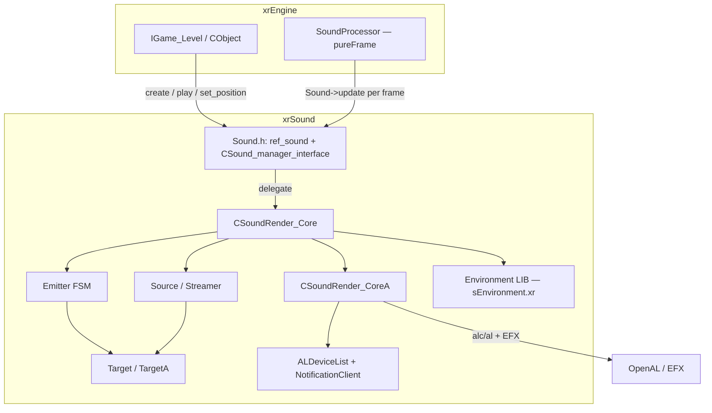

# Модуль: xrSound

`xrSound` — **модуль воспроизведения и 3D-симуляции звука** движка:
интерфейс `ref_sound`/`CSound_manager_interface`, ядро `CSoundRender_Core`
и OpenAL/EFX-бэкенд `CSoundRender_CoreA`. Отвечает на вопрос «как звук
звучит в 3D-пространстве: позиционирование, затухание по расстоянию,
окклюзия, реверберация окружения».

**Чего НЕ делает**: не описывает, *какие* звуки играют на события
(логика выбора файлов — в `CObject`/`CLevel`/Lua, xrGame/xrEngine),
не декодирует Ogg-файлы в плоских данных (декодер — внутри Source),
не делает музыкальный секвенсор (музыка — тот же `ref_sound` c
`st_Music`).

См. [Карта модулей](../../architecture/module-map.md), [Граф связей](../../architecture/dependencies.md).

## Структура

| Страница                                     | Что покрывает                                                                                                                                                                                                                                                                                                                                                                                                                                                                                          |
| -------------------------------------------- | -------------------------------------------------------------------------------------------------------------------------------------------------------------------------------------------------------------------------------------------------------------------------------------------------------------------------------------------------------------------------------------------------------------------------------------------------------------------------------------------- |
| [Интерфейс и точка входа](interface.md)      | `Sound.h` (`ref_sound`/`ref_sound_data`, `CSound_manager_interface`, `CSound_emitter`, `CSound_source`, `CSound_params`, `CSound_stats(_ext)`, флаги, `soundSmoothingParams`), `sound.cpp` (`_create`/`_destroy`), `SoundRender.h` (константы), глобалы `psSound*`/`psReverb*`                                                                                                                                                                |
| [Core — ядро](core.md)                        | `SoundRender_Core.cpp` (контейнеры sources/emitters/targets, `create/attach_tail/clone/destroy/play*`, `_create_data`, `set_geometry_*`, `get_environment`, `pause_emitters`), `SoundRender_Core_StartStop.cpp`, `SoundRender_Core_SourceManager.cpp`                                                                                                                                                                                                  |
| [Core — процессор и окружение](core-processor-env.md) | `SoundRender_Core_Processor.cpp` (полный разбор `update`-шагов, `update_events`, `statistic`, `get_occlusion`/`get_occlusion_to`), `SoundRender_Environment.h/.cpp` (`CSoundRender_Environment` — EAX-поля, `load`/`save` v4/v5, `lerp`/`clamp`, `SoundEnvironment_LIB` — `sEnvironment.xr`, `reverbs[]` 113 пресетов), EFX-применение в CoreA (`LoadEffect`/`load_reverb`/`commit`/`set_listener`/`get_listener`)                                                                                                                                                                                                                   |
| [Source + Target](source-target.md)          | `SoundRender_Source.h/.cpp` (загрузка WAV/Ogg 44100 Hz, метаданные из Ogg-комментариев v1–v3, `i_decompress_fr` 16-bit PCM, `ov_error`), `SoundRender_Source_loader.cpp` (ov-callback'ы, `LoadWave`, `load`/`unload` — `$level$`→`$game_sounds$`→`$no_sound.ogg`), `SoundRender_Target.h/.cpp` (абстрактный: ленивый `attach`/`dettach`, stub-API), `SoundRender_TargetA.h/.cpp` (OpenAL: 3 ALbuffer, `buf_block` 400ms, 3D-параметры с flip -z, gain/pitch с гистерезисом, underrun), `SoundRender_Cache.h/.cpp` (LRU: line + page-table, `initialize` удваивает память, `request` hit/miss/eviction), `fill_block`/`fill_data`/курсор/attached-переход (путь данных, FSM — порц. 9), consumer-side `get_occlusion_to` (ит.3 порц.4)                                                                                          |
| [Emitter](emitter.md)                        | `SoundRender_Emitter.h/.cpp` (`CSoundRender_Emitter : CSound_emitter` — активный экземпляр звука; поля, курсор + attached-переход, `Event_Propagade`/`Event_ReleaseOwner`, `set_*`/`switch_to_*`/`play_time`), `SoundRender_Emitter_FSM.cpp` (10 состояний, «demonized» preplay delay — smootherstep-замедление по расстоянию/343 м/с, `update`-шаги, `update_culling` — fade/окклюзия/`psSoundCull`/`i_allow_play`, `priority`), `SoundRender_Emitter_StartStop.cpp` (`start`/`i_stop`/`stop(bDeffered)`/`rewind`/`pause` по id/`cancel` — FATAL), владение `feedback`/`play_no_feedback`, `SoundRender_Emitter_streamer.cpp` (`fill_data` по LRU-линиям, `fill_block` — zero-pad/wrap-around/attached-рекурсия, как FSM-состояния управляют стримом)                                                                                                                                                                                                                                                                                       |
| [Устройства и прочее](devices-misc.md)       | `SoundRender_CoreA.h/.cpp` (`CSoundRender_CoreA : CSoundRender_Core` — устройство OpenAL/EFX: `A_CHK`/`AC_CHK` (DEBUG-only), 31 EFX-процедур `LOAD_PROC`, `LoadEffect`/`load_reverb`/`commit`/`DestroyEffect` (aux-слот, `m_is_supported`), `set_listener`/`get_listener` (EAX↔env, bug GAINHF→RoomLF, PAN закомм.), `_initialize` stage 0/1 (device→context→listener→EFX→pre-создание `psSoundTargets` targets с self-healing `snd_targets`), `switch_device` (hard-swap: destroy targets → reopen → re-init → `LoadEffect` → restart emitters), `refresh_devices`/`default_device_changed`, `_clear`, `update_listener` (EMA-скорость power=1.8/alpha=0.125, flip −z, `bListenerMoved`); глобалы `reverb_overwrite` + 21 `psReverb*`, `soundSmoothingParams`), `OpenALDeviceList.h/.cpp` (Creative Labs 2005: `ALDeviceDesc`, `Enumerate` — `ALC_ENUMERATE_ALL_EXT` + `UTF8_to_CP1251` + срез « on » + `snd_devices_token`, `SelectBestDevice`, `GetDeviceName/DescByName/Version`), `NotificationClient.h/.cpp` (Windows Core Audio `IMMNotificationClient` — аудио-поток, только volatile-флаги `bPendingDefaultDeviceSwitch`/`bPendingDeviceListRefresh` → `Core::update`), `cl_intersect.h` (дубль `xrEngine/cl_intersect.h`), `guids.cpp` (`INITGUID` вместо `dxguid.lib`), статистика (указание на core §8)                                                                                                                              |

## Карта связей

- **Потребители**: xrEngine (`IGame_Level::Load` → `Sound->set_geometry_occ`,
  `SoundProcessor::OnFrame` → `Sound->update`, `xr_ioc_cmd` →
  `snd_restart`/`sounddevice`), xrGame (`CObject`-звук: `ref_sound` в
  объектах, `Feel::Sound`, `SoundEvent_Register`).
- **Зависимости**: xrCore (`IReader`/`IWriter`, `xr_vector`, `shared_str`),
  xrCDB (`CDB::MODEL`/`COLLIDER` — `geom_DB`/`geom_SOM`/`geom_MODEL`/`geom_ENV`),
  OpenAL + EFX (efx-headers, `AL/efx-presets.h`), Windows Core Audio
  (COM `IMMDeviceEnumerator`, только в `NotificationClient`).
- **Публичный API**: глобал `CSound_manager_interface* Sound`
  (`Sound.h`) — единственная точка входа; фабрика-статик `_create(stage)`.
- `XRSOUND_API` (dllexport) **закомментирован** — модуль статический
  (аналог `PARTICLES_API` в [xrParticles](../xr-particles/index.md)).

## Статус порционов (итерация 4)

| #   | Порцион                           | Страницы                  | Статус    |
| --- | --------------------------------- | ------------------------- | --------- |
| 5   | Звук: интерфейс и точка входа     | `index.md`, `interface.md`| ✅ готово |
| 6   | Звук: Core — ядро                 | `core.md`                 | ✅ готово |
| 7   | Звук: Core — процессор и окружение| `core-processor-env.md`   | ✅ готово |
| 8   | Звук: Source + Target             | `source-target.md`        | ✅ готово |
| 9   | Звук: Emitter                     | `emitter.md`              | ✅ готово |
| 10  | Звук: устройства и прочее         | `devices-misc.md`         | ✅ готово |
