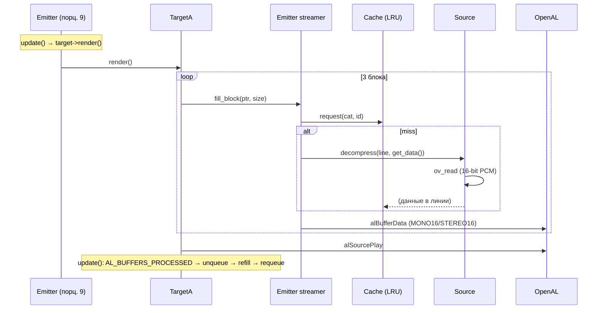
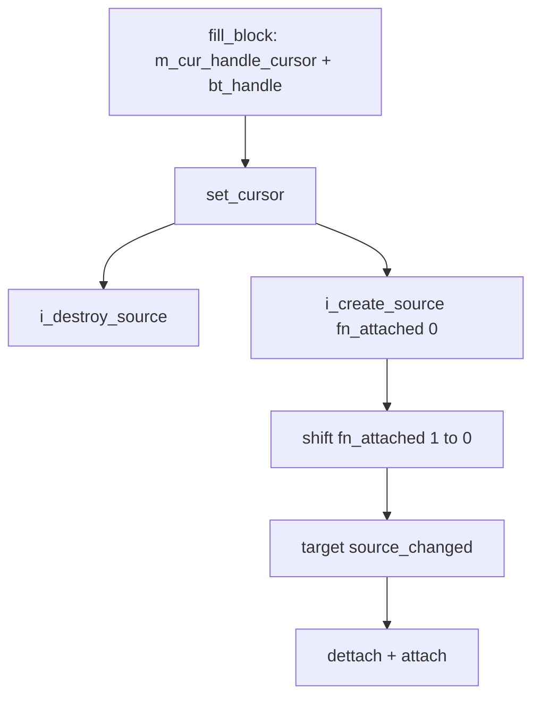

# xrSound — Source + Target + Cache

Слой «данных» звукового бэкенда: **откуда** берутся сэмплы (Source —
загрузка и стриминг Ogg/Wave через LRU-кэш) и **куда** они пишутся
(Target — OpenAL-источник с буферами). Файлы:

- `src/xrSound/SoundRender_Source.h` / `.cpp`
- `src/xrSound/SoundRender_Source_loader.cpp`
- `src/xrSound/SoundRender_Target.h` / `.cpp`
- `src/xrSound/SoundRender_TargetA.h` / `.cpp`
- `src/xrSound/SoundRender_Cache.h` / `.cpp`
- `src/xrSound/SoundRender_Emitter_streamer.cpp` — только путь данных
  `fill_block`/`fill_data`/курсор/attached-переход (FSM эмиттера —
  [порцион 9, emitter.md](emitter.md))

Связанные страницы: [Интерфейс](interface.md) (порц. 5: `CSound_source`,
`ref_sound`), [Core — ядро](core.md) (порц. 6: контейнеры, `get_occlusion_to`),
[Core — процессор](core-processor-env.md) (порц. 7: EFX-слот),
[Emitter](emitter.md) (порц. 9).

## 1. Ответственность

| Класс | Ответственность |
| ----- | --------------- |
| `CSoundRender_Source : CSound_source` | Загрузка аудиофайлов (WAV/Ogg), метаданные (дистанции, громкость, тип) из Ogg-комментариев, стриминг: `decompress()` — декодирование одной линии кэша по требованию |
| `CSoundRender_Cache` | LRU-кэш декодированных сэмпл-линий с фиксированным размером линии; page-table на source, вытеснение старых линий |
| `CSoundRender_Target` (абстрактный) | Обёртка над «куда писать»: ленивое открытие Ogg (`attach`/`dettach`), передача данных через `get_data()`; stub-реализации API |
| `CSoundRender_TargetA : CSoundRender_Target` | OpenAL-реализация: `ALsource` + 3 `ALbuffer`, заполнение блоками, 3D-параметры (позиция/дистанции/roll-off), gain/pitch с гистерезисом, underrun-обработка |
| `fill_data` / `fill_block` (в Emitter) | Путь данных Target→Emitter→Cache→Source: чтение линий из кэша в AL-буферы, конец файла, loop, переход на attached-звук |

См. также [index.md](index.md) — место модуля в архитектуре.

## 2. Место в архитектуре

```
ref_sound (interface.md)
  └─ CSoundRender_Core (core.md)
       ├─ m_sources: ref_sound → CSoundRender_Source (эта страница)
       │    └─ CSoundRender_Cache (LRU)
       └─ m_emitters: CSoundRender_Emitter (порц. 9, emitter.md)
            ├─ source() → CSoundRender_Source
            └─ target() → CSoundRender_TargetA (эта страница)
                 └─ ALsource + ALbuffer[3] → OpenAL device (CoreA, порц. 10)
```

- Source создаётся в `CSoundRender_Core::_create_data` (порц. 6) —
  один экземпляр на `ref_sound_data`, разделяется всеми эмиттерами
  этого звука.
- Target создаётся в `CSoundRender_Emitter::start` (порц. 9) —
  один на активный эмиттер, из пула `psSoundTargets`.
- Данные текут: **Source** (дек) → **Cache** (LRU) →
  **fill_block/fill_data** (стример) → **TargetA** (AL-буферы) → OpenAL.

## 3. Публичный API

### `CSoundRender_Source` (наследует `CSound_source` из [interface.md](interface.md))

| Метод | Назначение |
| ----- | ---------- |
| `bool load(shared_str name, CSoundRender_Cache* cache)` | Загрузка: `LoadWave` (WAV) или `ov_open` (Ogg); выбор `$level$` → `$game_sounds$`; метаданные из Ogg-комментариев; `cache.cat_create` |
| `void unload()` | `ov_clear`, освобождение `wave`, сброс полей |
| `bool decompress(void* dest, size_t& bytes, unsigned offset, void* src, unsigned size)` | Декодирование одного участка; обёртка над `i_decompress_fr` |
| `unsigned get_bytes_total()`, `float get_length_sec()` | Полный размер и длительность (`fTimeTotal = sdef_source_footer + bytes/avg_bps`) |
| `unsigned channels_num()`, `bool looped()` | Каналы; loop — флаг `stPlayingLooped` на данных |
| `bool i_decompress_fr(ov_read_info*, ...)` | Внутренний цикл `ov_read` (16-bit PCM, `bigendian=0`) |

Конструктор по умолчанию: `m_fMinDist=1`, `m_fMaxDist=300`,
`m_fMaxAIDist=300`, `m_fBaseVolume=1`, `m_uGameType=0`.

### `CSoundRender_Target` (абстрактный базовый)

| Метод | Назначение |
| ----- | ---------- |
| `void* get_data()` | Ленивый `attach()` при `!wave`; возвращает `&ovf` (Ogg-контекст) |
| `void attach()` | `FS.r_open` + `ov_open_callbacks` с 4 ov-callback'ами (extern — объявлены в `Target.cpp`, **определены в `Source_loader.cpp`**) |
| `void dettach()` | `ov_clear` + закрытие `wave` |
| `start/render/stop/rewind/update/fill_parameters` | Stub'ы (ASSERT) — реальная реализация в `TargetA` |

Поля: `m_pEmitter`, `rendering`, `priority`, `ovf` (`OggVorbis_info`),
`wave` (`IReader*`).

### `CSoundRender_TargetA`

Публичный API — те же методы, что в базе (реализация), плюс:
`source_changed()` (перезахват: `dettach`+`attach` — вызывается при
attached-переходе из `fill_block`), `fill_block(ptr, size)`
(см. §4.4).

### `CSoundRender_Cache`

| Метод | Назначение |
| ----- | ---------- |
| `initialize(_total_kb_approx, bytes_per_line)` | Выделение: **удваивает** запрос (`*= 2`), `_count = total*1024/line + 1`, `R_ASSERT(_count < CAT_FREE)` |
| `cat_create(bytes, line)` → `cache_cat*` | Page-table: `size = ceil(bytes/line)` строк, заполнено `0xffffffff` |
| `bool request(cat, id)` | `id %= size`; hit → `move2top`, `_stat_hit++`, FALSE; miss → `_stat_miss++`, promote старейшей (eviction), TRUE (нужен fill) |
| `get_dataptr(cat, id)` | `c_storage[cat.table[id%size]].data` |
| `disconnect`/`purge`/`format`/`destroy` | Пересборка LRU / очистка / освобождение |

## 4. Внутреннее устройство

### 4.1 Source: загрузка

- **`LoadWave` требует строго 44100 Hz**: иначе `Msg` warning +
  `return false` (файл не загружается, звук будет fallback
  `$no_sound.ogg`). 16-bit PCM всегда (`wBitsPerSample=16`).
- `fTimeTotal = sdef_source_footer + dwBytesTotal / nAvgBytesPerSec`
  (`sdef_source_footer` — константа из `SoundRender.h`, «хвост» на
  конец стрима).
- **Ogg-комментарии** — версии метаданных:
  - `0x0001`: minDist/maxDist/gameType (baseVolume = 1.0);
  - `0x0002`: + baseVolume;
  - `OGG_COMMENT_VERSION = 0x0003`: + maxAIDist.
  - Неверные/отсутствующие комментарии — только `-dbg` log.
- **`load()`**: имя приводится к нижнему регистру, расширение срезается;
  попытка `$level$`, затем `$game_sounds$`; если не найдено — fallback
  `$game_sounds$/$no_sound.ogg`. Успех `LoadWave`/`ov_open` →
  `cache.cat_create(CAT, dwBytesTotal)`.

### 4.2 Source: декодирование

`i_decompress_fr` — цикл `ov_read` до заполнения линии кэша
(16-bit PCM, `bigendian=0`). Рядом закомментирован float-вариант
(мёртвый код).

`ov_error` (callback в `Source_loader.cpp`):
`OV_HOLE` / `OV_EBADLINK` → true (восстановимо — пропускаем дыру),
остальные ошибки → false (невосстановимо).

`Source_loader.cpp` также содержит 4 ov-callback'а (`read`/`seek`/
`close`/`error`), которые `extern`-объявлены в `Target.cpp` и
используются `attach()` — **межфайловая зависимость**
Target→Source_loader.

### 4.3 Cache: LRU с фиксированными линиями

- `cache_line`: двусвязный список + `data`-указатель +
  `loopback` (u16* обратно в слот `cat.table` — дублирующая
  связь) + `id` (u16).
`cache_cat`: `u16* table` (page-table, по слоту на линию source)
  + `size` (строк). `CAT_FREE = 0xffff`.
- **`initialize` удваивает** запрошенную память (`*_total_kb_approx *= 2`,
  «to avoid bad configs») — фактический размер кэша в 2 раза больше
  cvar'а. `R_ASSERT(_count < CAT_FREE)` (65535).
- **`request(cat, id)`**: `id %= size`; hit → `move2top` + `_stat_hit++`,
  вернуть FALSE (данные есть); miss → `_stat_miss++`,
  `move2top(c_end)` (старейшая поднимается наверх = кандидат на
  вытеснение), её loopback очищается, `cptr = c_begin->id`
  ассоциируется, TRUE (нужен fill).
- `cat_create`: `size = ceil(bytes/line)`, table выровнено по
  чётности, заполнено `0xffffffff`.
- `get_dataptr`: `c_storage[cat.table[id%size]].data`.

### 4.4 Target / TargetA

**TargetA** — `pSource` + `pBuffers[sdef_target_count]` (3 буфера),
`Slot` (EFX aux-слот), `buf_block`.

Глобалы `g_target_temp_data` (8-bit sized `buf_block`) и
`g_target_temp_data_16` (×2) — общие временные буферы, переразмериваются
в `start()` на каждый target.

- `_initialize`: `alGenBuffers(3)`, `alGenSources(1)`,
  `LOOPING=FALSE`, `MIN_GAIN=0`, `MAX_GAIN=1`,
  GAIN/PITCH из кэша.
- `start`: `buf_block = sdef_target_block(400ms) * nAvgBytesPerSec / 1000`.
- **`render()`**: заполнить 3 блока, queue, установить aux send filter
  (`Slot` если `!= -1 && !bIntro`, иначе `AL_EFFECTSLOT_NULL` —
  «demonized: disable effects by null slot»), `alSourcePlay`.
- **`update()`**: `AL_BUFFERS_PROCESSED` → unqueue/refill/requeue loop;
  underrun: `processed==0 && state!=PLAYING` → replay.
- **`fill_parameters()`** — 3D-параметры:
  `AL_REFERENCE_DISTANCE` / `AL_MAX_DISTANCE` из
  `p_source.min_distance`/`max_distance`;
  `AL_POSITION`/`AL_VELOCITY` с **flip по `-z`**
  (Y-up→Z-up); `AL_SOURCE_RELATIVE = b2D`;
  `AL_ROLLOFF_FACTOR = psSoundRolloff`;
  gain из `smooth_volume` (clamp EPS_S..1, гистерезис 0.01);
  pitch = `p_source.freq * psSpeedOfSound` (clamp EPS_L..2,
  гистерезис) — при смене pitch для не-looped не-paused
  пересчитывается `fTimeToStop`.
- **`fill_block(ptr, size)`**: формат MONO16/STEREO16 по числу
  каналов; вызов `m_pEmitter->fill_block(...)` (стример, путь данных
  §4.5) + `alBufferData`.
- **`source_changed()`**: `dettach` + `attach` — вызывается при
  attached-переходе.

### 4.5 Путь данных (стример, из `Emitter_streamer.cpp`)

> FSM, который **запускает** этот путь (`start`/`update`/`cancel`/
> `rewind`) — [порцион 9, emitter.md](emitter.md). Здесь — только
> механика Source/Target/Cache.

**`fill_data(dest, offset, size)`**:
- Итерация по линиям кэша: `cache.request` → при miss
  `source()->decompress(line, target->get_data())`;
  `CopyMemory` из `cache.get_dataptr`.
- Обработка не-выровненной первой линии (частичная).

**`fill_block(ptr, size)`** (конец данных / переходы):
- `stPlaying` → zero-pad остатка.
- `stPlayingLooped` → wrap-around loop.
- **Attached-переход**: при переходе на следующий source
  (`m_cur_handle_cursor + bt_handle`), `set_cursor` вызывает
  `i_destroy_source` / `i_create_source(fn_attached[0])` + сдвиг
  `fn_attached[1]→[0]` + `target->source_changed()`.

`get_bytes_total` / `get_length_sec` делегируют в `owner_data`
(`ref_sound_data`).

## 5. Взаимодействие

| С чем | Как |
| ----- | --- |
| [Core — ядро](core.md) (порц. 6) | Core создаёт/уничтожает `CSoundRender_Source` в `_create_data`; `get_occlusion_to` — реализация в Core (порц. 6), **consumer-side** — здесь: `fill_parameters` TargetA использует результаты окклюзии для gain |
| [Core — процессор](core-processor-env.md) (порц. 7) | `Slot` (EFX aux) — устанавливается в `render()` TargetA; EFX-пресеты — в Environment |
| [Emitter](emitter.md) (порц. 9) | Emitter — владелец Target; `fill_block`/`fill_data` — путь данных Emitter→Target; FSM запускает/останавливает |
| OpenAL (CoreA, порц. 10) | `ALsource`/`ALbuffer` — целевое устройство; device init — в CoreA |
| xrCDB | `geom_*` (окклюзия) — через Core (порц. 6), не напрямую здесь |

## 6. Потоки данных

### Заполнение буфера (каждый кадр, per-target)



### Attached-переход (конец первого звука → второй)



## 7. Конфигурация

| Cvar / константа | Назначение |
| ---------------- | ---------- |
| `sdef_target_block` (400ms) | Размер блока TargetA (мс) |
| `sdef_target_count` (3) | Число AL-буферов на target |
| `sdef_source_footer` | «Хвост» в `fTimeTotal` |
| `cache_bytes_per_line` | Размер линии кэша |
| `psSoundRolloff` | Roll-off фактор (gain) |
| `psSpeedOfSound` | Скорость звука (pitch scaling) |
| `bIntro` | Флаг: disable EFX (null slot) |
| `OGG_COMMENT_VERSION` (0x0003) | Версия метаданных |
| `EPS_S` / `EPS_L` / гистерезис 0.01 | Clamp/gain/pitch |

Все cvar'ы объявлены в [interface.md](interface.md) (порц. 5).

## 8. Известные ограничения / дебаг

- **`LoadWave` hard-44100 Hz**: файлы с другой частотой не загружаются
  (только `Msg` warning). Это ограничение формата, не bug.
- **Cache удваивает память**: `initialize` делает `*_total_kb_approx *= 2`.
  Реальный размер кэша в 2 раза больше cvar'а — учитывайте при
  профилировании.
- **`sdef_source_footer`** в `fTimeTotal` — добавляет фиксированный
  «хвост» к длительности; может давать небольшой over-estimate.
- **Attached-переход**: при переходе `i_destroy_source` +
  `i_create_source` + `source_changed` — это атомарно по кадру, но
  если `i_create_source` упадёт (файл не найден), переход не
  произойдёт.
- **Underrun**: `AL_BUFFERS_PROCESSED == 0 && state != PLAYING` →
  replay. Это защита от голода, но может дать «скачок» при
  high-load.
- **Float-вариант `i_decompress_fr`** — закомментирован (мёртвый код).
- **`cl_intersect.h`** (xrSound, 25KB) — проверить дублирование с
  `xrEngine/cl_intersect.h`; если дубль — [порцион 10,
  devices-misc.md](devices-misc.md). Здесь не анализируется.
